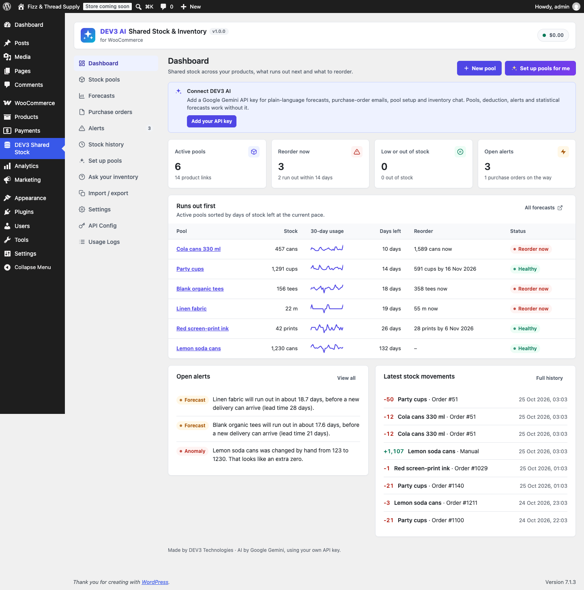

# DEV3 AI Shared Stock & Inventory for WooCommerce

Shared stock pools, variable deduction, attribute stock rules and AI stockout forecasts for WooCommerce.



## Features

Sell one physical stock through many products. A **stock pool** holds the real units (cans, metres of fabric, blank tees); every product, variation or attribute value linked to it deducts from the same number.

**Shared stock**

* Pools shared by products, variations and attribute values (for example every "Linen" item draws from the linen fabric pool).
* Variable deduction: a 6-pack deducts 6, half a metre of fabric deducts 0.5.
* Kits: link one product to several pools and each sale deducts from all of them.
* Correct across orders, cancellations, refunds with restock, failed/pending round trips and admin order edits (36 tested scenarios, legacy and HPOS order storage).
* Product stock is kept in sync, so the storefront, the quantity box, feeds, the REST API and the block checkout show the shared stock.
* A whole-cart check stops two products from one pool being bought beyond what it holds (classic and block cart/checkout).
* Works with Product Bundles, Composite Products and Mix and Match line items (choose which lines deduct).
* Low-stock and out-of-stock alerts by email, a full stock history log, CSV import (with preview) and export.

**DEV3 AI (optional, your own Google AI key)**

* Stockout forecast per pool: statistics first (blended daily rate, trend, weekday pattern, 95% safety buffer), then DEV3 AI explains it in plain words.
* Reorder suggestions with quantity and date, and purchase-order emails drafted for your supplier. Review, edit, then send.
* "Set up pools for me": reads your products and attributes and proposes pools to accept, edit or reject.
* Anomaly alerts: sudden stock drops and likely typos (an extra zero, swapped digits); DEV3 AI explains them and suggests a fix you approve.
* Ask your inventory: "What will run out before Black Friday?"

Everything works without AI: forecasts, reorder suggestions, template purchase orders, rule-based pool setup and built-in answers.

## Requirements

- WordPress 6.0 or newer (tested up to 6.8)
- PHP 7.4 or newer
- WooCommerce 8.0 or newer (required)
- Optional: your own Google AI API key (from Google AI Studio) to switch on the DEV3 AI features. The rest of the plugin works without one.

## Installation

### From the release zip

1. Download `dev3-ai-shared-stock-for-woocommerce.zip` from the [latest release](https://github.com/dev3tech/dev3-ai-shared-stock-for-woocommerce/releases/latest).
2. In WordPress, go to **Plugins → Add New → Upload Plugin**, choose the zip and click **Install Now**.
3. Click **Activate**.

### Build from source

```bash
git clone https://github.com/dev3tech/dev3-ai-shared-stock-for-woocommerce.git
cd dev3-ai-shared-stock-for-woocommerce
composer install --no-dev
npm ci
npm run build
```

Then copy the `dev3-ai-shared-stock-for-woocommerce` folder into `wp-content/plugins/` and activate it.

### Getting started

1. Upload the plugin zip under Plugins > Add New > Upload, then activate it. WooCommerce must be active.
2. Make sure WooCommerce > Settings > Products > Inventory > "Enable stock management" is on.
3. Open **DEV3 Shared Stock** in the admin menu, create a pool and link products (or use "Set up pools for me").
4. Optional: add a Google AI API key under API Config to turn on the DEV3 AI features.

## FAQ

### Does it change my products' stock?
Yes, linked products get "Manage stock" turned on and a quantity of pool stock divided by units per sale. You can turn this off in Settings.

### What happens to old orders when I change a link?
Each order line remembers the pools and quantities it used, so cancellations and refunds always return exactly what was taken.

### Is my API key safe?
The key is stored encrypted on your server and never sent to the browser. Inventory data is sent to Google AI only when you use a DEV3 AI feature.

## Documentation

The full HTML guide (installation, settings, hooks and FAQ) is in [`docs/index.html`](docs/index.html). Open it in a browser after cloning or downloading the repository.

## Changelog

### 1.0.0
* Initial release.

## Licence

Released under the GNU General Public License v2.0 or later (GPL-2.0-or-later). See [LICENSE](LICENSE).

## More from DEV3

- [DEV3 AI Shared Stock & Inventory for WooCommerce on the DEV3 Marketplace](https://www.dev3.tech/item/dev3-ai-shared-stock-for-woocommerce)
- [More WordPress plugins, themes and templates from DEV3](https://www.dev3.tech/marketplace)
